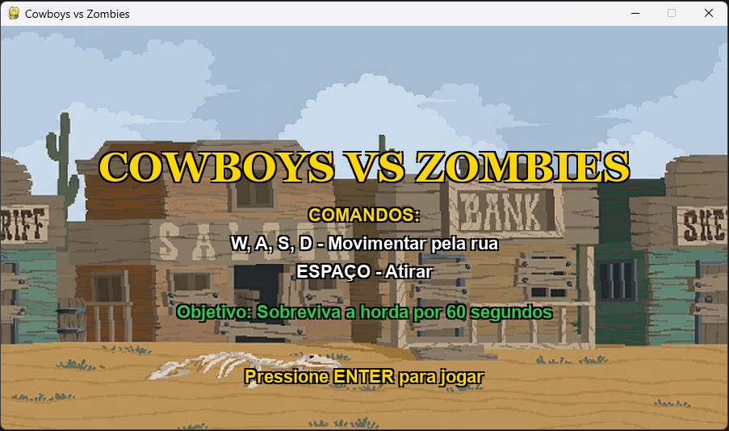
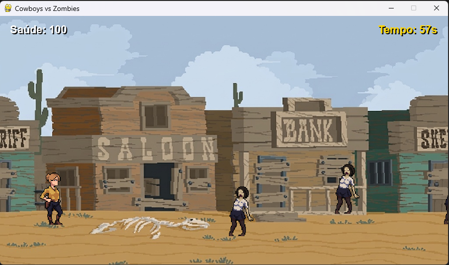

# 🤠 Cowboys vs Zombies

Jogo de ação e sobrevivência 2D em estilo pixel art desenvolvido em Python com Pygame, estruturado sob os princípios de **Programação Orientada a Objetos (POO)** para a disciplina de **Linguagem de Programação Aplicada** (Uninter).

---

## 🎯 Sobre o Jogo

Em uma cidade do velho oeste tomada por mortos-vivos, você assume o papel de uma cowgirl defendendo a rua principal. Seu objetivo é **sobreviver à horda de zumbis durante 60 segundos** antes que sua saúde chegue a zero.

## 📸 Capturas de Tela

| Menu Inicial | Gameplay |
| :---: | :---: |
|  |  |

### Regras e Mecânicas
- **Sobrevivência:** O cronômetro regressivo inicia em `60s`. Sobreviver até o tempo zerar garante a **Vitória**.
- **Combate:** Cada disparo acerta o zumbi à frente; se um zumbi encostar na cowgirl, ela perde pontos de saúde.
- **Limites de Cenário:** A movimentação ocorre exclusivamente na faixa da rua principal, com spawn aleatório de inimigos pela borda direita.

---

## 🎮 Comandos

| Tecla | Ação |
| :--- | :--- |
| **`W` `A` `S` `D`** | Movimenta a personagem pela rua |
| **`ESPAÇO`** | Dispara o revólver |
| **`ENTER`** | Inicia a partida / Retorna ao menu |
| **`ESC`** | Encerra o jogo |

---

## 🏗️ Arquitetura do Projeto

O código foi modularizado separando configurações, entidades e controle de estados:

```text
cowboys-vs-zombies/
├── asset/              # Sprites e cenário em pixel art
├── code/
│   ├── __init__.py
│   ├── Const.py        # Constantes globais (resolução, FPS, cores, velocidades)
│   ├── Entity.py       # Classe base abstrata para entidades do jogo
│   ├── Player.py       # Controle, animação de tiro e limites da Cowgirl
│   ├── Enemy.py        # Lógica de spawn e movimentação dos zumbis
│   ├── Bullet.py       # Comportamento e dano dos projéteis
│   ├── Menu.py         # Tela inicial com instruções e controles
│   ├── Level.py        # Loop da fase, HUD (saúde/tempo) e colisões
│   └── Game.py         # Gerenciador de telas (Menu, Fase, Vitória e Game Over)
├── main.py             # Ponto de entrada da aplicação
└── requirements.txt    # Dependências do projeto
